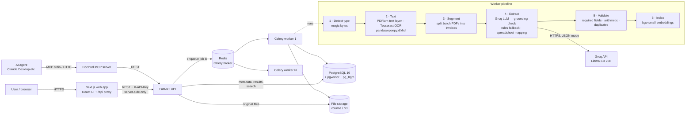

# Architecture

## Request flow

1. **Upload** `POST /api/documents` streams each file to storage in 1 MB chunks (never fully in memory), hashes it (SHA-256 for duplicate-file detection), checks the magic bytes against the extension, writes a `documents` row with status `queued`, and returns `202` immediately with the document ids.
2. **Queue.** The id is pushed to Redis. Workers take one job at a time (`prefetch=1`, `acks_late`), so a worker that crashes mid-document has its job redelivered rather than lost.
3. **Process** (`app/processor.py`). Each stage writes a `processing_events` row (stage, status, duration, message), and progress is written to the document row at most twice a second. The UI polls `GET /api/documents/status?ids=…`.
4. **Results.** The document ends as `completed`, `needs_review` (at least one invoice failed a rule) or `failed` with a stable `error_code`.

## Key design decisions

| Decision | Why | Trade-off |
|---|---|---|
| **Python end-to-end (FastAPI + Celery)** instead of NestJS + a Python OCR service | OCR, pandas, PDF and LLM code are all Python. One language means one data model, no inter-service contract, and less to deploy. Celery/Redis is the Python equivalent of BullMQ. | No TypeScript on the backend. Explained here as the brief allows. |
| **PDFium text layer first, OCR only for pages with < 40 chars** | Digital pages take ~5 ms; OCR takes ~1.5–3 s/page. Most AP PDFs are digital, so this is the biggest speed lever. | A digital page with an image-only total box would be missed (rare). Threshold is configurable (`MIN_TEXT_CHARS`). |
| **Parallel page ranges in worker processes** (25-page chunks) | A 1000-page scanned PDF is CPU-bound OCR; chunks spread it across cores and report progress as they finish. | PDFium can't share handles across processes, so each chunk re-opens the file (cheap). |
| **Two-pass OCR** (dense block mode + sparse-text mode, merged) | Tesseract's block mode keeps table rows together but drops isolated header fields (e.g. right-aligned "Invoice No"). The sparse pass recovers them. Measured: fixed the remaining missing invoice numbers on scans. | ~+0.4 s per scanned page. `OCR_SPARSE_PASS=false` to disable. |
| **Batch segmentation by invoice number** | A 1000-page AP PDF is usually hundreds of invoices plus T&C pages. A new invoice starts when the page shows a different invoice number; pages without one attach to the previous invoice. | Two consecutive invoices with no visible numbers would be merged (flagged as missing number). |
| **LLM + grounding check + rule fallback** | The LLM handles unseen layouts. Every value it returns is then looked for in the source text and removed if absent, which enforces "never invent values". The rule extractor fills gaps and keeps the system working when the free tier rate-limits. | Grounding can remove a legitimate value that OCR garbled. That shows up as a reviewer warning (`UNGROUNDED_VALUE`), not a silent loss. |
| **Spreadsheets mapped by header names, no LLM** | Ledgers and exports are already structured; header synonyms ("Invoice No", "Vendor", "Grand Total"…) map them exactly and instantly, with one row per invoice or per line item. | Unusual headers fall back to text extraction. |
| **Postgres + pgvector** instead of a separate vector DB | One store for metadata, results, history and vectors means transactional consistency (delete a document and its vectors go too), HNSW index, and SQL filters combined with vector search. | At very large scale (100M+ vectors) a dedicated vector store may be warranted. |
| **Hybrid search** | AP staff mostly search exact things (invoice numbers, supplier names), so keyword hits rank first; semantic neighbours (bge-small-en-v1.5, CPU, no API) follow above a similarity floor. | — |
| **SQLite + in-process worker fallback** | `uvicorn app.main:app` runs with zero infrastructure for development, tests and the evaluation. | Not for production: single writer, brute-force vector search. |

## Performance, scalability, reliability

- **Throughput scales with workers.** The API is stateless and only accepts uploads; run more Celery workers (`TASK_MODE=celery`). The measured single-worker numbers are in [evaluation-report.md](evaluation-report.md).
- **LLM rate limits.** Calls go through a semaphore (`LLM_CONCURRENCY`), honour `Retry-After` on 429, back off exponentially on 5xx and timeouts, and drop to rules after `LLM_MAX_RETRIES`. Long documents are clipped to head + tail (totals live at the end) to stay inside free-tier token limits.
- **Failure isolation.** One unreadable page in a 1000-page PDF is logged as a warning, not a document failure. Corrupted, encrypted, empty, mismatched or oversized files fail fast with specific codes (`corrupted_pdf`, `encrypted_pdf`, `type_mismatch`, `too_large`, `no_text`…). `POST /api/jobs/reprocess-failed` re-queues them all.
- **Idempotent reprocessing.** Reprocessing deletes derived rows (pages, invoices, vectors) and rebuilds them; history and attempt counters are kept.

## Security

- Optional API key (`X-API-Key`, constant-time compare) on every `/api` route except health. The Next.js server injects it, so the key never reaches the browser.
- Uploads: extension allow-list **and** magic-byte check (a renamed `.exe` is rejected), streaming size limit, per-request file limit, per-IP upload rate limit, decompression-bomb guard on images, and files stored under random UUID names (no path traversal; original names are sanitised and used only for display).
- Strict CORS allow-list, security headers (`nosniff`, `DENY` framing, `no-referrer`), generic 500 responses (details only in server logs), non-root containers.
- Manual edits are audited (`corrections` table: who, when, old → new) and survive re-validation.
- Not included (would be next for production): user accounts/SSO and per-user permissions, antivirus scanning of uploads, encryption at rest for the uploads volume, and a Redis-backed rate limiter for multi-node deployments.
