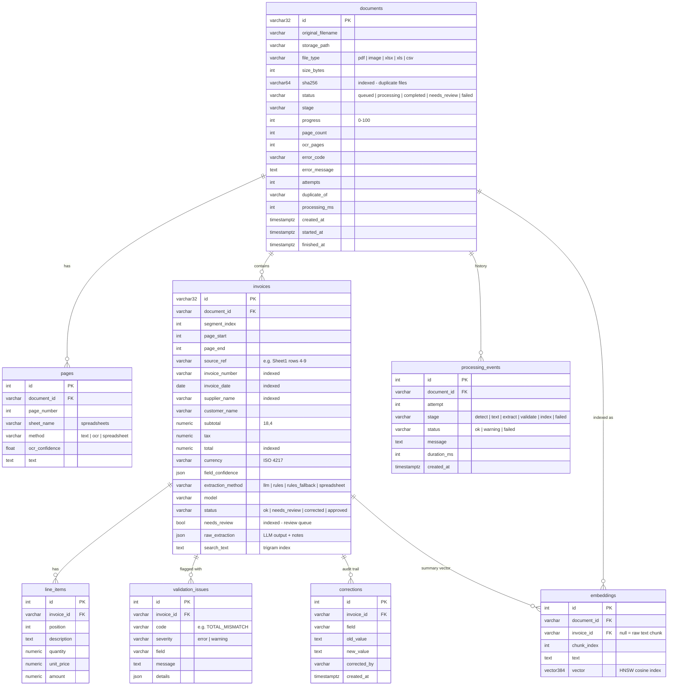

# Database schema

PostgreSQL 16 with the `vector` (pgvector) and `pg_trgm` extensions. Tables are created by SQLAlchemy on startup (`app/models.py`); SQLite is supported for local development.

## Notes

- **Money** is `NUMERIC(18,4)`, never float, so validation arithmetic is exact.
- **One document → many invoices.** A batch PDF or a ledger spreadsheet yields many `invoices` rows. `page_start/page_end` or `source_ref` point back to where each came from.
- **Indexes** serve the API's hot paths: review queue (`needs_review`), duplicate detection (`supplier_name, invoice_number`), filters (`invoice_date`, `total`, `currency`), keyword search (`gin_trgm_ops` on `search_text`) and semantic search (HNSW on `embeddings.vector`).
- **Deletes cascade**: removing a document removes its pages, invoices, issues, corrections, events and vectors in one transaction.
- **`raw_extraction`** keeps the LLM's untouched JSON and the grounding notes, so reviewers and auditors can see exactly what the model said versus what was kept.

## Validation issue codes

| Code | Severity | Meaning |
|---|---|---|
| `MISSING_FIELD` | error for number/date/supplier/total, warning for others | Field not found in the document |
| `TOTAL_MISMATCH` | error | subtotal + tax ≠ total (beyond rounding) |
| `LINE_ITEM_MATH` | error | quantity × unit price ≠ line amount |
| `LINE_ITEMS_SUM_MISMATCH` | error | Line amounts don't add up to subtotal (or total, if tax-inclusive) |
| `SUBTOTAL_EXCEEDS_TOTAL` | error | Subtotal larger than total |
| `DUPLICATE_INVOICE` | error | Same supplier + invoice number already in another source document |
| `DATE_IN_FUTURE` / `DATE_IMPLAUSIBLE` | error | Date > 30 days ahead or before 2000 |
| `NEGATIVE_AMOUNT`, `ZERO_TOTAL`, `TAX_RATE_UNUSUAL`, `INVALID_CURRENCY`, `TOTAL_UNEXPLAINED`, `NO_LINE_ITEMS` | warning | Suspicious but possibly legitimate |
| `LOW_CONFIDENCE` | warning, triggers review | A field was extracted with confidence < 0.6 |
| `UNGROUNDED_VALUE` | warning, triggers review | The LLM returned a value not present in the text; it was removed |
| `LLM_FALLBACK` | warning | LLM unavailable; rule-based extraction used |
